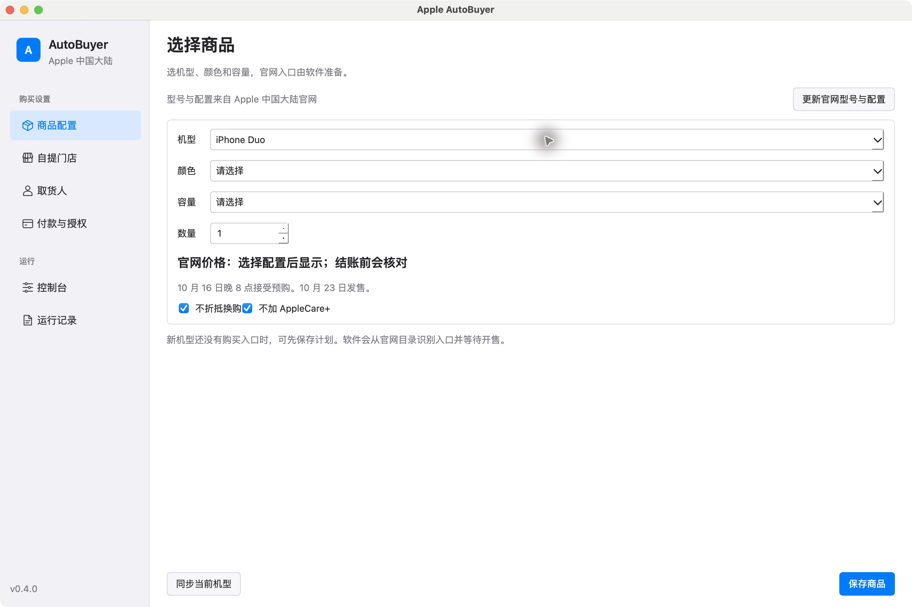

# iPhone AutoBuyer for macOS

Apple 中国大陆官网 iPhone 17、18 系列与 Duo 的购买准备、真实网站试跑与受条件保护的下单工具。Python / PySide6 / Playwright，Apple Silicon。

**v0.7.10**：软件独立 Chrome 与内置浏览器的专用购物袋中，若只有同一机型、相同数量的旧颜色或容量，重新核对已公布 SKU 后将旧商品移入官网收藏，确认空袋再准备当前配置。配置一致则继续复用购物袋和结账门店切换；其他商品、数量变化、SKU 不明或收藏未成功时保留现场。日常 Chrome 的购物袋不自动整理。「控制台 → 诊断… → 检查购物袋」可记录实际商品、SKU、数量及预选标签，只读不加购；记录不含账号、联系人或完整页面内容。

加购后同时观察直接进入购物袋和配件页的「查看购物袋」入口，正常慢加载不再于 8 秒中断。页面就绪立即继续，最多等待 45 秒或更长的已设置操作时限；结果不明时保留页面，不重复加购。

自提门店保存后出现短暂旧状态时，观察目标门店真正选中，再读取签到时段；不重复选择门店。**build 56 已在软件自己的内置浏览器完成无人推进网页的真实现货验证**：iPhone 17 白色 256GB、1 件、RMB 6,799、南京东路自提、招商银行 24 期，约 110 秒至订单确认，自动提取付款码。该轮复用已核对一致的购物袋，未实际付款；详情和首发验证边界见[验证清单](docs/VERIFICATION.md)。

v0.7.9 的登录修复保留：独立 Chrome 登录成功后返回中国官网首页，不再误报为“登录页已离开 Apple 官网”。首页与商店页继续通过正常购物袋账户入口验证，不凭记住的账号确认登录，也不重复提交密码。当轮独立 Chrome 的密码认证、商店回调均返回 200；更新重开后，受保护账户页返回 200，软件确认原有登录有效。此前真实认证 503 的服务器原因仍未确定，详情见[登录诊断](docs/LOGIN_DIAGNOSIS.md)。

v0.7.8 的优化保留：商品、金额、付款及核对页文字合并为一次当前 DOM 读取，保留核对阶段和提交前的两次独立检查。人工完成账户验证并返回结账后清除已完成的登录尝试记录，后续正常过期时可再尝试一次。日常 Chrome 已由软件创建真实 18 Pro 待付款订单并自动提取招商银行二维码；登录与签到时段有人工推进，不能称为全程自动验收。

v0.7.7 的修复保留：识别官网新空袋提示，并在自提结账中选择必选的签到时段；已选的有效时段保留，新增选择等官网保存后再继续。重复接入日常 Chrome 会复用当前连接，不重新打开授权页。登录恢复原有覆盖输入，避免调试版本把记住的邮箱重复追加。历史独立和内置浏览器的认证 503 记录见[登录诊断](docs/LOGIN_DIAGNOSIS.md)。

v0.7.6 的入口策略保留：控制台可选择「每 5 秒刷新入口」或「停留等待放行」，默认使用刷新策略，旧配置也默认刷新。等待进店页面不再强制停留；正在加载的请求及服务器指定等待仍保留。识别已知等待提示，并检查真正可操作的商品配置/购买控件；未知首发文案或仅有标题不会被当作已经进店。预配置 SKU 到开售时间后仍未开放时继续入口检查。

v0.7.5 的付款选择与自动提交保留：不限定招商银行 24 期。支付宝、微信支付使用普通付款；花呗分期、微信分付与银行方案按所选期数检查。首选银行不可用时，备用普通付款不会继承银行期数；两种浏览器均在最终核对通过后提交一次。官网是否提供该方式、是否要求额外验证仍由实际页面决定。

结账跳转按页面变化观察，页面就绪立即继续；门店继续和最终核对允许较慢的正常加载，不再固定在 15 秒报失败。核对页尚未就绪时保留购物袋和已发起的跳转，不重复点击「检查订单」。

账号密码和取货资料默认加密保存在本机，退出重开后自动载入，不需要再次输入、系统钥匙串确认或另外设置授权密码。两个表单均可取消「记住在这台电脑上」改为仅本次使用。

取货门店勾选后，等待官网保存选择，再核对门店并继续填写取货详情。保存失败或超时保留购物袋，普通资源请求不影响这一等待。真实官网验收和开发回归分别记录在[验证清单](docs/VERIFICATION.md)。

账户结账等待 Apple 登录框真正载入，再使用本机已保存账号；不在表单加载途中切换游客。内置浏览器会先恢复网页视图并确认控件动作生效，付款方式与分期方案也等待官网保存结果再继续。官网的验证码仍由本人完成。

记录表格更换行数前清理旧的辅助功能单元格缓存，避免停止任务后刷新记录时的 Qt 崩溃，表格仍可正常读取和选择。

v0.7.3 的直接输入和 TXT 导入功能保留，默认存储由仅本次使用改为本机保存。登录与下单不自动读取旧钥匙串；旧记录保留，选择旧取货人时可重新填写。

v0.7.2 的购物袋恢复保留：真实购买可复用核对一致的购物袋，直接进入结账检查门店，避免重复加购。取货页首选店缺货时，按已保存的允许门店优先级切换；缺货发生在“继续”之后，也在同一结账页处理，并更新实际门店。没有可取货门店时保留购物袋。

购物袋加载中不会被当成空袋；只有出现商品控件或明确空袋提示才继续，未识别的页面保留。取货页尚未显示某家允许门店时，也不会把未读取的状态报成无货。

v0.7.1 的默认隐私自动同意与 56 个官网 SKU 直达配置继续保留，无软件二次确认窗口或额外授权密码。v0.7.0 的平台整理与 [Windows 迁移准备](docs/WINDOWS_PREPARATION.md) 保留；路线评估见 [自动化路线判断](docs/AUTOMATION_ROUTE.md)。

v0.6.4 已验证的内置登录修复继续保留。系统中文、地区德国时原先产生 `zh-DE`，现为中国商店设置 `zh-CN,zh`。实际内置浏览器已完成认证、双重验证、商店回调与受保护账户页，软件确认登录成功；未更改网络、认证域名、浏览器标识或安全设置。独立 Chrome 与日常 Chrome 连接仍可使用。这次结果支持语言配置是该内置登录失败的重要因素，不能据此保证所有官网 503 / 541 均已消除。详情见 [登录诊断](docs/LOGIN_DIAGNOSIS.md) 与 [验证清单](docs/VERIFICATION.md)。

提前设置账户：打开「官网浏览器 → 填写 Apple 账号密码…」，输入后点「使用此账户」，默认保存到本机，并启用自动登录和信任浏览器。重新打开后自动载入；编辑同一账户时密码留空即可保留。取货人直接输入姓氏、名字、证件后四位、手机和邮箱，点击「使用此取货人」后保存并设为默认。无需额外软件密码，也不调用原生钥匙串。配置、导出和日志不含这些字段；删除本机账号不注销浏览器已有登录。旧钥匙串记录需要重新填写一次，软件不自动迁移旧密码。

可在两个表单中导入同一个 UTF-8 TXT，各自只填写对应字段。导入不立即登录、发送资料或下单，也不会复制源文件。TXT 中的密码是明文，密码等号后的空格按原样保留。格式如下（将示例替换为自己的内容）：

```text
账号=你的Apple账号
密码=你的密码
姓氏=你的姓氏
名字=你的名字
证件后四位=1234
手机号=你的手机号
邮箱=你的邮箱
```

信任浏览器由 Apple 决定，不能承诺登录一次后永久免验证码。「记住我的账户」与通过验证、信任浏览器分别识别。541 是仍需处理的官网请求异常，账号保存功能不代表已经消除它。

用户已确认旧版同一软件独立 Chrome 在开启回国 VPN 后重新输入密码登录成功；网络路径是重要变量，具体原因仍待细分。可保留独立 Chrome 并使用这条已成功的网络路径提前登录，软件不自动切换 VPN。正常购买程序在本机运行，不依赖 Codex 在线；VPN 切换导致 Codex 断线与 Apple 登录结果分别判断。

直接选择机型、颜色、容量、门店和付款；不用寻找或粘贴 SKU。目录已从官网读取 Duo、17、17e、18 Pro、18 Pro Max，分别保存 8、10、6、16、16 个公开配置链接及价格，选完配置自动使用对应 SKU。没有唯一匹配时使用官网机型页；SKU 返回 404 时回到其官网机型页，仍按原选择核对。官网价格变化或未读到时用金额明确的按钮确认。Duo 的官网开售时间可一键填写。

官网可在软件内显示，也可使用软件独立 Chrome 或通过官方扩展接入日常 Chrome。软件独立 Chrome 使用软件专用资料，日常 Chrome 模式在浏览器内沿用用户已授权的会话。代理、Safari 自动购买、多入口并行刷新没有加入本版，尚未验证首发优势。当前界面与验收见 [产品需求与迭代](docs/PRODUCT_REVIEW.md)、[发布前自查](docs/PreMortem-iPhone-AutoBuyer-2026-10-12.md)、[验证清单](docs/VERIFICATION.md)。



**实际验证边界：** 2026-10-14（北京时间）软件 build 56 从商品页开始核对，复用软件会话中已准备的 iPhone 17 白色 256GB 购物袋，自动完成南京东路自提、签到时段、取货资料、招商银行 24 期及单次提交，生成 1 个 RMB 6,799 的真实待付款订单并自动提取付款码；这一轮没有人工推进网页，未实际付款。此前 build 47 的日常 Chrome 18 Pro 订单包含人工恢复账户和选择签到时段，分别记录。现货成功不能替代 Duo 首发负载、未来认证验证或 Windows 真机验收；各类证据见 [验证清单](docs/VERIFICATION.md)。

历史 v0.4.3 / build 12 的稳定性检查保留在[验证清单](docs/VERIFICATION.md)。v0.4.0 的现货试跑 20.27 秒到达 Apple 数据隐私协议；尚未开售的 Duo 结账和双浏览器首发优势不宣称已经通过。

## 启动

本机应用：`~/Applications/iPhone AutoBuyer.app`，可通过 Finder 双击。首次在「诊断…」点击「检查环境」。内置浏览器随应用打包；独立模式使用已安装的 Google Chrome，没有 Chrome 且 Chromium 缺失时点击「安装浏览器」。

源码启动：

```sh
python3 -m venv .venv
.venv/bin/python -m pip install -r requirements.txt
.venv/bin/python -m playwright install chromium
# macOS 源码运行需先构建表格组件修补（Xcode Command Line Tools）：
.venv/bin/python scripts/build_accessibility.py
.venv/bin/python -m app.main
```

也可双击 `scripts/run.command`，需要事先安装依赖。

## 使用流程

1. 商品配置：直接选机型、颜色、容量和数量，点击「保存商品」。官网入口和已公布价格由目录准备；「更新官网型号与配置」读取当前公开页面。不猜未发布 SKU，也不把公布的价格当成有货。
2. 自提门店：设置省、市、区，从官网查询门店；添加允许门店，拖动决定优先顺序，勾选启用。列表外备用门店须单独允许。不会自动改为邮寄。取货日期限制无法在最终页面可靠确认时会暂停。
3. 取货人：点击「填写取货人」，直接填写姓氏、名字、邮箱、手机及证件后四位，或导入 TXT。身份证末位 X 也可填写，无需完整号码。点击「使用此取货人」后默认保存在本机，重开后自动载入并允许填写；可在付款页关闭自动填写。旧条目直接重新填写，不解锁旧资料。手机号验证码仍在官网输入。
4. 付款与授权：下拉选择首选方式，分期方案再选期数；普通付款显示「不选分期」。勾选备用方式并拖动排序，准备清单分别显示各方式实际使用的期数。Apple 中国大陆结账隐私自动同意默认已启用：软件勾选两个隐私选项并继续，不弹出二次确认窗口，不要求先保存声明版本。取消任一隐私选项可关闭自动同意；设置重启后保留。付款与分期方案仍由实际结账页面确认。
5. 控制台：用「登录并保持会话」登录，再点「检查登录状态」或「继续检查」；两者在预登录等待期间核验同一会话。「打开浏览器」前置软件的当前页面。先用「官网模拟下单」检查在售商品，试跑不会点击「立即下单」。试跑与真实购买均可复用型号、颜色、容量、数量和价格核对通过的已有购物袋；直接在结账页按允许门店优先级检查取货，不重复加购、删除商品或更改数量。门店缺货时在该页面切换符合条件的备用店；全部缺货保留购物袋，其他商品或数量不一致仍暂停。Duo 可点「使用官网开售时间」填入带时区的预约。真实购买前，准备清单会提示缺少的配置和取货人。
6. 软件检测到官网待付款确认页后，会提取唯一可见的付款二维码。用「查看付款二维码」查看，或「提取当前付款码」重读当前页面。付款窗口提供保存图片、复制图片和复制付款说明，方便由你转发给对应下单人；软件不会自行向别人发消息。
7. 「运行记录」分为运行阶段、门店变化、订单与付款码。门店列表显示上次检测结果、说明和检测时间，变化记录区分商品配置；旧结果不代表现在有货。多个历史订单可分别选中查看其付款码。

**当前自动提交条件：** 商品、全部已选配置、数量、最终总金额、允许门店及付款方案都必须可靠核对，不固定银行或期数。门店在当前结账页通过编号、已选状态、保存完成及进入取货资料页确认；最终页继续核对自提方式，无需再次显示门店名称。开启“条件满足后自动提交订单”并运行“开始抢购”后，软件自动提交一次，付款由你完成。“官网模拟下单”仍只到核对页；设置了取货日期范围但最终日期无法核实时会暂停。跳转到支付服务并不等于已取得 Apple 订单确认，结果未确认时保留提交锁，不重复下单。信用卡字段、Apple Pay 验证及不同支付服务的实际支付仍需按官网完成；各路径实测范围见验证清单。

## 前一天登录与开售检测

- 在「官网浏览器」直接点击「独立 Chrome 登录」或「内置浏览器登录」，完成官网验证后点「检查登录状态」或「已完成登录，检查」。当前实际成功路径为软件独立 Chrome。日常 Chrome 已登录时可点「接入日常 Chrome」，在官方扩展中审阅权限并选择一个 Apple 页面。商品设置、门店检查和购买共用选定浏览器。
- Codex 右侧浏览器、Safari、软件内嵌及独立 Chrome 的会话相互独立；日常 Chrome 模式在授权后直接沿用其会话。软件不复制其他浏览器的 Cookie，也不导出登录令牌。
- 内嵌浏览器使用私有持久目录并保存会话 Cookie；Chrome 保留自己的软件目录。Cookie 保存与 Apple 服务器是否继续承认登录分别判断，不承诺全天有效。
- 「停止任务」保留会话和订单锁。官网会话打开时，红色关闭按钮隐藏窗口并在菜单栏继续运行；退出软件才正常结束线程和浏览器。内嵌模式的「关闭会话」断开自动化连接，官网页面保留到退出软件。软件意外退出后可恢复仍在运行的软件 Chrome，不接管日常浏览器。
- 预约、时钟和运行记录统一显示北京时间。旧配置中的其他时区预约自动换算，保留同一开售时刻；保存后使用 `Asia/Shanghai`。过去的预约不能启动新真实购买，需更新未来时间或取消预约以立即开始。
- 控制台提供「检查登录状态」。预约购买在等待前检查；距离开售超过 10 分钟时，再在开售前 10 分钟复核一次。立即购买直接沿用会话，减少一次账户页往返。加载、维护、连接失败表示未知，只有明确登录表单表示需登录；两者都保留会话。
- 「付款与授权」可点选沿用登录后游客备用、只用 Apple 账户或无需预登录。已有登录直接结账；实际显示游客入口才按选择点击一次。手机验证出现时保留购物袋并提醒本人完成，不反复请求短信或提交密码。
- 登录后的加载页不会直接判为未登录：最多观察 15 秒，不再次提交密码。登录返回请求出现关键 403/429/541 时立刻显示原因、保留浏览器并等待，不把页面转圈误报成账号错误。
- 「记录登录问题」观察实际会话中的正常请求，不读取钥匙串或自动提交密码。覆盖 `idmsa.apple.com`、实际中国商店使用的 `idmsa.apple.com.cn` 和商店回调；认证 503 明确显示服务请求失败。记录不含密码、Cookie 值、动态 URL、查询参数、请求正文或响应原文。切换浏览器前须关闭当前会话，运行时显示诊断连接的浏览器。
- 预约时刻到达检查当前商品页。未开放、维护、普通拥堵和连接失败的入口检查持续按 5 秒节奏；按两次请求的开始时间计算，加载时间包含在其中，没有两分钟后变慢的限制。没有链接时按同样节奏读取官网已公布的入口。控制台默认「每 5 秒刷新入口」，等待进店提示同样按此策略重试；选「停留等待放行」时，已识别的等待页才保持不刷新。正在加载的请求继续观察，服务器指定等待仍遵守。选项保存后重开有效，运行中的任务使用启动时的选择。
- 首发页面即使换了文案，也先核对可操作的商品配置或购买控件，不能只凭标题或开售时间判断已经进店。开始购物袋、结账或账户流程后，入口刷新不作用于这些页面。
- HTTP 503 按 `Retry-After` 自动等待；403/429/541 的应用默认等待从 5 秒开始，连续失败逐步变为 10/20/40/60 秒，服务器要求更久时遵守更久的期限。一个页面的多项失败只记作一次回合，等待期限跨重启保留。只有公开 iPhone 入口的文档 GET 可以自动恢复尝试；登录、购物袋变更和结账不自动重发，显式安全验证或访问拒绝交由本人处理。541 的服务器原因未知，不等同于已证明封 IP；5 秒也不是 Apple 公布的保证安全参数。
- 访问受限时「继续检查」显示等待倒计时，期限内不可用；停止任务后再启动检查也不会跳过等待时间。
- 内置 [Apple 中国大陆零售店目录](https://www.apple.com.cn/retail/storelist/)，目前 49 家、25 个城市，可搜索、筛选、多选添加和排序。目录不代表有货。同城一次供货查询，跨城保留原门店优先级；新响应成功才更新时间，结账再次核对。无货检查逐步退避，默认上限 60 秒。
- 初始网络连接失败不会立即放弃整个计划。维护页、未开放的预购页、商品可选、自提可选和真实订单确认分别处理。
- 时间显示固定为北京时间；不更改 Mac 系统时间、官网地区、网络出口或账户地区。
- 「会话保持期间防止 Mac 自动睡眠」使用系统 `caffeinate`，在会话启动时生效，关闭会话/退出后释放。建议接电源；不能保证合盖、断网或系统强制睡眠时继续运行。
- 若官方提供提前准备/保存购物袋的入口，会显示检测结果；先在官网完成官方准备。不能把普通购物袋当作已创建的订单，也不会提前调用隐藏下单接口。

2026-10-11 官网观察显示 Duo 在 2026-10-16 晚 8 点（北京时间）接受预购，10 月 23 日发售。应在开售前再次核对官方通知。控制台的「使用官网开售时间」直接设置北京时间。

## 付款码与订单锁

- 只截图官网确认页中可见的二维码图片，不截图整页联系人、证件信息，不保存解码后的支付链接/令牌。
- 每张图片关联订单号和已核对的商品/金额/付款方案；未知商品或金额会明确留空，不能用预算上限冒充实际金额。
- 官网给出的 30 分钟等相对时限必须结合已知提交时刻计算。人工创建的订单若没有可靠起算时间，显示「起算时间未知，请以官网为准」，不会每次提取都重新开始倒计时。
- 已知期限到达后隐藏图片，并禁用保存/复制图片。同一订单重新打开不会延长原有期限。扫码或保存图片不代表已付款。
- 自动提交前以 SQLite 原子写入订单锁。提交超时、停止或崩溃均保留锁，不会盲目重试。当前会话可等待其正常订单确认页；重启后须通过 Apple 正常订单页面人工核对旧订单。
- 一个购买计划对应一个 intent。已确认或结果未知的计划不重复下单；重新购买时在「付款与授权」点击「创建新的购买计划」，保留旧锁并重新确认购买授权。
- 不自动取消或修改已创建订单。
- 运行中的任务使用启动时的配置副本；之后修改商品、付款和授权只影响下一次任务。

## 数据位置

`~/Library/Application Support/Apple AutoBuyer/`

正式 Chrome 使用其中的 `chrome-profile/` 独立目录，通过仅本机可连接的受支持调试连接执行正常网页操作；正常退出会让浏览器自行保存资料。`browser-profile/` 为旧 Chromium 会话，保留但不复制其 Cookie。本机重启测试能保留有到期时间及会话类型的合成 Cookie，不能据此承诺 Apple 的登录或结账永久有效。

- `autobuyer.sqlite3`：商品配置、门店、身份引用、阶段、脱敏结果、门店变化与订单锁；不含完整身份证、电话号码、邮箱或密码。
- `chrome-profile/`：正式 Chrome 的软件独立会话；目录权限 700。
- `embedded-profile/`：内嵌浏览器的持久存储和缓存；目录权限 700，密码不进入应用配置或日志。
- `browser-profile/`：旧 Chromium 资料，保留。
- `public-catalog.json`：已读取的公开型号、配置、SKU 链接与价格；不保存账户或身份。
- `private-inputs/records.enc`：加密的账号、密码及取货资料；`local.key` 是应用随机生成的本机解密密钥。使用 [Fernet](https://cryptography.io/en/latest/fernet/) 的认证加密，目录与文件在 macOS 分别为 700/600。密钥与数据同目录，保护边界是当前系统账户及目录权限，不属于硬件或钥匙串保护；不提供跨电脑复制登录能力。
- `checkout-diagnostic.json`：当前结账阶段；门店阶段另保存公开的按钮、门店名称及编号，不保存联系人表单、页面正文或动态 URL。
- `website-cooldown.json`：拒绝与临时繁忙的等待期限；不保存 IP、URL 或 Cookie。
- `login-diagnostic-chrome.json` / `login-diagnostic-embedded.json`：有界的请求类别、公开域名、状态码与页面能力；文件权限 600。Cookie 开启与 WebCrypto 可用不等于已确认登录。
- `payment-qr/`：付款二维码图片与订单元数据；目录权限 700、文件 600。图片含付款能力，只在本机保存，是否转发由你决定。
- 取消「记住在这台电脑上」后，输入仅本次使用，临时引用不写入配置或导出。保存文件损坏或密钥缺失时保留原文件并提示，不覆盖原数据。旧原生安全存储服务和记录保留，当前 GUI 与登录/购买流程不自动读写这些记录。用户主动导入的 TXT 是明文源文件，软件只读取选中的本机文件，不复制或上传源文件。

配置导出不包含身份资料；配置导入不授予填写身份、真实下单，并清除导入文件的隐私开关。新计划默认启用 Apple 中国大陆结账的两个隐私选项，旧版本元数据保留以兼容配置，不再作为自动同意的正文版本门槛。日志和浏览器异常不会输出填写值。工程忽略二维码、私有测试报告、数据库、虚拟环境和构建产物。

## 测试

```sh
.venv/bin/python -m pytest -q
.venv/bin/python -m app.main --local-test all --headless --report reports/local.json
.venv/bin/python -m app.main --smoke-test --screenshot reports/gui.png
```

本地模拟商店只用于开发异常测试，使用合成身份、合成订单。覆盖首店/次店/无货、库存变化、缺失配置、付款不可用、身份缺失、维护、网络超时、提交超时、延迟成功、服务器拒绝、429 和停止。真实 Chromium 的离线 DOM 测试覆盖图片标签银行、分期期数、延迟出现的 AppleCare 选项、真实确认页结构、付款码裁取、单次提交保护以及跨任务保留会话 Cookie。

可选真实网站试跑（永不自动提交，也不加载身份）：

```sh
.venv/bin/python -m app.main --live-check --config scripts/stocked-example.json --report reports/live-check.json
```

真实网站试跑若出现限流会暂停，不以本地成功替代真实验证。

仅核验软件浏览器的公开商品供货读取（不加购、不结账、不读取身份）：

```sh
.venv/bin/python scripts/inspect_stock.py --checks 2 --interval 90 --output reports/apple-stock-software.json
```

该开发检查使用软件正常的浏览器与私有会话目录；本机已安装 Chrome 时采用软件独立 Chrome。`--wait-for-load` 仅用于对比等待完整页面加载的受控实验。v0.2.2 的几个独立自动化对照曾遇 541；v0.3.0 的程序已经连续两次读取 12 家门店供货（间隔 60 秒），报告为 `reports/apple-stock-repeat-20261012.json`。这项检查没有身份填写、加购或订单提交。

登录兼容性诊断使用软件「官网浏览器 → 记录登录问题」。旧的临时 Chrome 探测脚本已移除，避免与当前正常浏览器启动方式分叉。

## 打包

```sh
./scripts/build.command
./scripts/install.command
```

生成 `dist/iPhone AutoBuyer.app`，安装脚本复制到 `~/Applications`。更新已有本机 App 时先保留带时间戳的上一版。包内包含 Python、GUI、Playwright 驱动和模拟 HTML；Chromium 采用独立版本缓存，可通过 GUI 安装。构建仅为本机进行 ad-hoc 签名，不是公开发行的 Developer ID 公证包。

`prepare_plugins()` 处理此工作目录忽略文件被自动标为 Finder 隐藏后导致 Qt 发现不到 Cocoa 插件的问题，只调整软件自己的插件隐藏标记，不关闭系统安全保护。打包脚本清除生成 App 的 FinderInfo/ResourceFork 元数据后签名，不删除 quarantine。

Windows 的系统依赖与 PowerShell 入口已整理，真机移植仍待验收，见 [Windows 迁移准备](docs/WINDOWS_PREPARATION.md)。

## 验证与资料

- [已验证/待验证清单](docs/VERIFICATION.md)
- [官网研究与开售策略](docs/RESEARCH.md)
- [产品需求、心蓝参考与迭代记录](docs/PRODUCT_REVIEW.md)

任何实际库存、首发开放、可选付款方式和取货承诺都以当前 Apple 页面为准。
